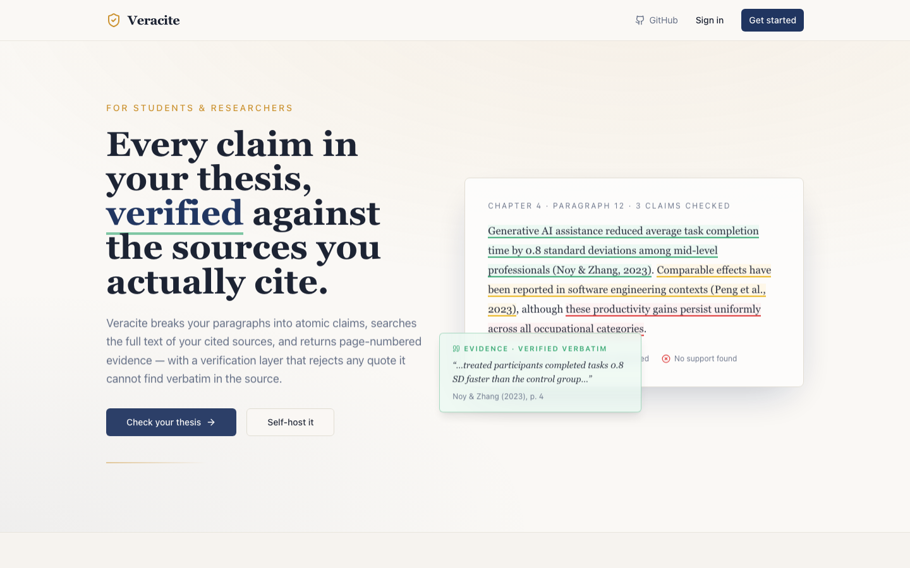

# Citeproof

**Every claim in your thesis, verified against the sources you actually cite.**

Plagiarism checkers tell you what you copied. Citeproof tells you whether what you *wrote* is actually supported by what you *cite*. Upload your source PDFs and your draft, and every paragraph is broken into atomic claims, checked against the **full text** of the sources it cites, and returned with quoted, page-numbered evidence — color-coded green, yellow, or red.



## Why this exists

Supervisors and committees increasingly ask one question: *"Does this source really say that?"* Answering it by hand means re-reading every PDF for every sentence. LLMs can help, but a plain chatbot will happily invent a supporting quote. Citeproof is built around one rule: **evidence that cannot be found verbatim in the source is rejected.**

## How it works

1. **Build your source library.** Drag in the PDFs you cite. Title, authors, year, and an in-text citation label are extracted automatically (editable).
2. **Upload your thesis.** The draft is segmented into paragraphs; sections like *References* and *Acknowledgements* are auto-skipped. Citations are detected and matched to your library — unmatched ones are flagged so you can spot missing sources.
3. **Read the verdicts.** Each paragraph is split into 2–6 atomic claims. For each claim, the model searches the entire text of the cited sources and returns a verdict with quoted evidence and page numbers.

| Verdict | Meaning |
|---|---|
| 🟢 Green | Claim fully supported by the cited source(s) |
| 🟡 Yellow | Partially supported or uncertain |
| 🔴 Red | No support found in the cited sources |
| 🔵 Blue | Not checkable (headers, reference entries, …) |

For red verdicts, a rewrite tool either re-grounds the claim in a source from your library (with the supporting quote) or rephrases it as a defensible observation.

## What makes the verification trustworthy

- **Hallucination guard.** Every evidence excerpt returned by the model is re-validated against the source's extracted text with fuzzy word-by-word matching. Excerpts that don't exist are discarded and the verdict is downgraded to "no verifiable support."
- **Citation-scoped evidence.** Evidence is only accepted from the sources a claim actually cites — the model can't borrow support from elsewhere in your library.
- **Token-level PDF highlighting.** Supporting passages are located inside the original PDF via sliding-window token matching (tolerant to OCR noise) and highlighted on the exact page, so every verdict can be checked by eye.
- **Robust citation matching.** `Smith (2023)`, `(Smith et al., 2023)`, and `Smith & Jones, 2023` resolve to the same source through exact → key-based → fuzzy matching with ±1 year tolerance. APA 7, MLA 9, Chicago, Harvard, IEEE, and Vancouver are supported.
- **Audit trail.** Every check is stored with its claims, verdicts, and evidence, so you can revisit exactly what was verified and when.

## Architecture

- **Frontend:** React 18 + TypeScript + Vite, shadcn/ui, Tailwind. PDF parsing and paragraph segmentation run in the browser (pdf.js) — hyphenation repair, abbreviation-aware sentence splitting, and section classification included.
- **Backend:** Supabase — Postgres with per-user row-level security, Storage for uploaded PDFs, and Deno edge functions for all AI calls.
- **AI:** Google Gemini 2.5 Flash Lite via edge functions. The API key lives server-side only.
- **Auth:** Supabase Auth (email + password). All tables are scoped to the signed-in user; uploads are namespaced per user in storage.

```
src/lib/
  pdf-parser.ts        paragraph segmentation, section classification
  pdf-text-map.ts      token-level PDF indexing for highlight rects
  citation-detector.ts citation extraction + multi-stage matching
  source-matching.ts   score-based citation→source resolution
  text-anchors.ts      stable claim positions across views
supabase/functions/
  check-paragraph/     claim extraction + verification + evidence validation
  rewrite-claim/       grounded rewrites for unsupported claims
  ai-chat/             metadata extraction helper
  dedupe-citations/    AI-assisted citation deduplication
```

## Run it yourself

You need Node 18 or newer and a Gemini API key from [Google AI Studio](https://aistudio.google.com/apikey) (the free tier is enough). The backend is [Supabase](https://supabase.com): run it on your own machine with Docker, or use a free hosted project. The migrations create the tables, row-level security policies and the storage bucket, so there is nothing to set up by hand.

### On your machine (Docker)

```sh
git clone https://github.com/alvinekelund/citeproof
cd citeproof
npm install

# Postgres, Auth, Storage and the edge runtime in Docker; applies the migrations
npx supabase start

# Edge functions with your Gemini key (keep this terminal open)
cp supabase/functions/.env.example supabase/functions/.env   # paste your key into it
npx supabase functions serve --env-file supabase/functions/.env
```

In a second terminal:

```sh
cp .env.example .env
# VITE_SUPABASE_URL             = the API URL printed by `supabase start` (http://127.0.0.1:54321)
# VITE_SUPABASE_PUBLISHABLE_KEY = the publishable (anon) key printed by `supabase start`
npm run dev   # http://localhost:8080
```

Open the app, choose **Create one**, and sign up with any email address. Local accounts need no email confirmation. `npx supabase status` prints the URL and keys again, and Supabase Studio runs at http://127.0.0.1:54323.

### Hosted Supabase

```sh
cp .env.example .env   # URL + publishable (anon) key from Project Settings → API
npx supabase link --project-ref <your-project-ref>
npx supabase db push
npx supabase secrets set GOOGLE_AI_API_KEY=<your-gemini-key>
npx supabase functions deploy
npm run dev
```

Hosted projects ask new users to confirm their email by default, and the app tells them to check their inbox. If you run Citeproof only for yourself, you can turn confirmation off under **Authentication → Sign In / Providers → Email**.

To put the frontend online, `npm run build` writes a static site to `dist/` that any static host can serve (Vercel, Netlify, Cloudflare Pages). Set the two `VITE_SUPABASE_*` variables in the host's build settings and add the site's address under **Authentication → URL Configuration**.

To show a **Try the demo account** button on the login page, create that account in Supabase Auth and set `VITE_DEMO_EMAIL` and `VITE_DEMO_PASSWORD` in `.env`. The password ships to the browser, so use a throwaway account.

> **Note on storage privacy:** uploaded files are written to a per-user folder and only the owner can write there, but the bucket is public-read (paths are unguessable). For stricter confidentiality, flip the bucket to private and switch `getFileUrl` in `src/lib/supabase-helpers.ts` to signed URLs.

## Honest limitations

- Verdicts are produced by an LLM. The hallucination guard ensures quoted evidence is real, but a green verdict is still a judgment call — treat it as a fast first pass, not a substitute for reading your sources.
- Scanned PDFs without a text layer need OCR before upload.
- Very long sources are checked against their extracted text; extraction quality bounds verification quality.

## License

[MIT](LICENSE) — © Alvin Ekelund
